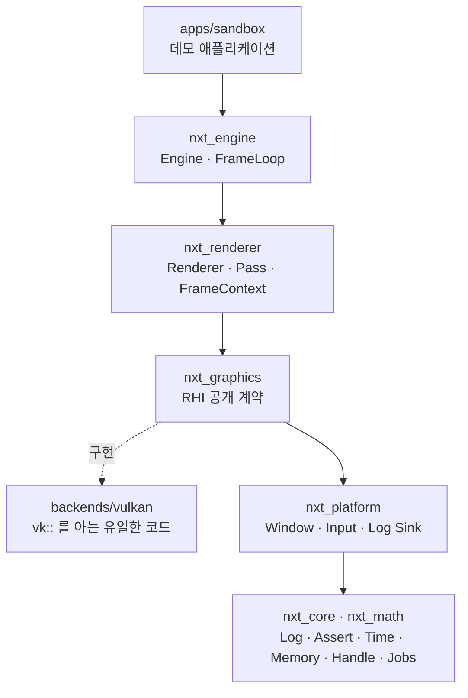

<div align="center">

# NXT-Engine

[](https://isocpp.org/)
[](https://www.vulkan.org/)
[](https://cmake.org/)
[](#요구-사항)
[](LICENSE)

Vulkan 위에 직접 올린 RHI를 축으로, 계층 경계와 수명 규칙을 코드로 강제하는 엔진입니다.

</div>

---

## ✨ 특징

| | |
|---|---|
| **RHI 경계** | `vk::` 타입은 `graphics/backends/vulkan` 안에만 존재합니다. 렌더러와 엔진은 Vulkan을 모릅니다. |
| **측정 우선** | 측정되지 않은 병목에는 최적화를 넣지 않습니다. CPU 런타임도 Phase 1의 측정 결과가 근거입니다. |
| **명시적 수명** | GPU 리소스는 fence 기반으로 지연 파괴합니다. use-after-free를 구조로 막습니다. |
| **의존 단방향** | `core → platform → graphics → renderer → engine → app`. 역방향 의존을 만들지 않습니다. |
| **얇은 추상화** | 소비자가 없는 추상화는 만들지 않습니다. 지금 필요한 만큼만 계층을 둡니다. |

## 🏗️ 아키텍처



프레임은 `acquire → record → submit → present` 순서로 흐르고, 엔진이 present 시점을 소유합니다.

## 📁 프로젝트 구조

```text
NXT-Engine/
├─ apps/sandbox/      데모 앱 — 창을 열고 삼각형을 그린다
├─ src/nxt/
│  ├─ core/           로그 · assert · 시간 · 메모리 · 핸들 · 동시성 · 잡
│  ├─ math/           vec3 · mat4
│  ├─ platform/       Window(HWND) · 입력 · 로그 sink — Win32
│  ├─ graphics/       RHI 계약 + Vulkan 백엔드
│  ├─ renderer/       Renderer · Pass · Mesh · FrameContext
│  ├─ engine/         Engine · FrameLoop
│  └─ assets/         애셋 매니저 — Phase 2
├─ shaders/           GLSL 소스 (빌드 시 SPIR-V로 컴파일)
├─ tests/             doctest 기반 단위 테스트
├─ docs/              설계 문서 · 로드맵 · 코딩 규칙
└─ cmake/             셰이더 컴파일 헬퍼
```

## 🚀 시작하기

### 요구 사항

- **Windows 10/11 x64** — 현재 대상 플랫폼 (Linux는 백엔드 자리만 있음)
- **Visual Studio 2026** 또는 **MinGW + Ninja**
- **CMake 3.25+**
- **Vulkan SDK 1.4+** — `find_package(Vulkan)`과 `glslangValidator`를 사용합니다

### 빌드

```powershell
# MSVC (Visual Studio)
cmake --preset msvc
cmake --build --preset msvc-debug

# 또는 MinGW + Ninja
cmake --preset mingw
cmake --build --preset mingw-debug
```

셰이더는 빌드 과정에서 자동으로 SPIR-V로 컴파일되어 실행 파일 옆 `shaders/`로 복사됩니다.

### 실행

```powershell
./build/msvc/apps/sandbox/Debug/sandbox.exe
# MinGW: ./build/mingw/apps/sandbox/sandbox.exe
```

깊이 테스트가 적용된 삼각형 두 개가 표시됩니다.

### 테스트

```powershell
ctest --preset msvc --output-on-failure
```

## 🗺️ 로드맵

| 단계 | 목표 | 상태 |
|---|---|---|
| **Phase 0** | 삼각형 — RHI 경계와 프레임 루프 검증 | ✅ 완료 |
| **Phase 1** | 10만 삼각형과 CPU 런타임, 병목 측정 | 🚧 예정 |
| **Phase 2** | 실제 데이터 — glTF 로딩과 GPU 업로드 | 📋 계획 |

각 Phase는 기능 목록이 아니라 **아키텍처를 검증하는 순서**로 설계되어 있습니다.

## 📚 문서

- [설계 문서](docs/design/rhi.md) — RHI 경계, 프레임 수명, Scene/World 분리
- [로드맵](docs/README.md) — Phase별 목표와 완료 기준
- [코딩 규칙](docs/CODING_RULES.md) — 명명, 포맷팅, 소유권, 동시성 규약

## 🤝 기여

- 코드를 수정하기 전에 [CODING_RULES.md](docs/CODING_RULES.md)를 읽어주세요.
- 커밋은 `feat(scope):`, `fix(scope):`, `docs(scope):` 형태의 Conventional Commits를 따릅니다.
- 제출 전 `clang-format`과 테스트를 통과해야 합니다.

## 📄 라이선스

[MIT License](LICENSE) © 2026 바벨드는자
