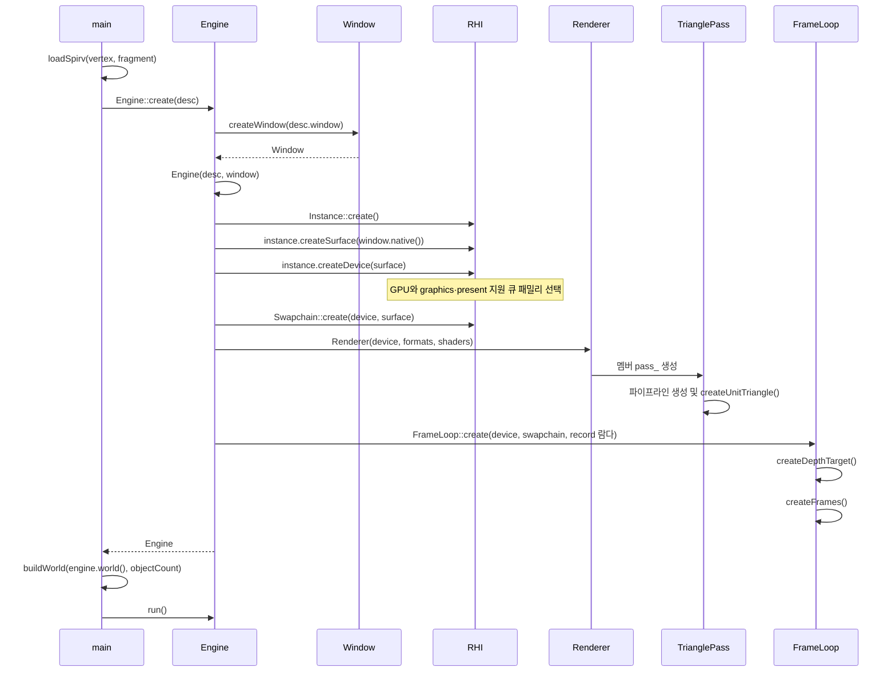
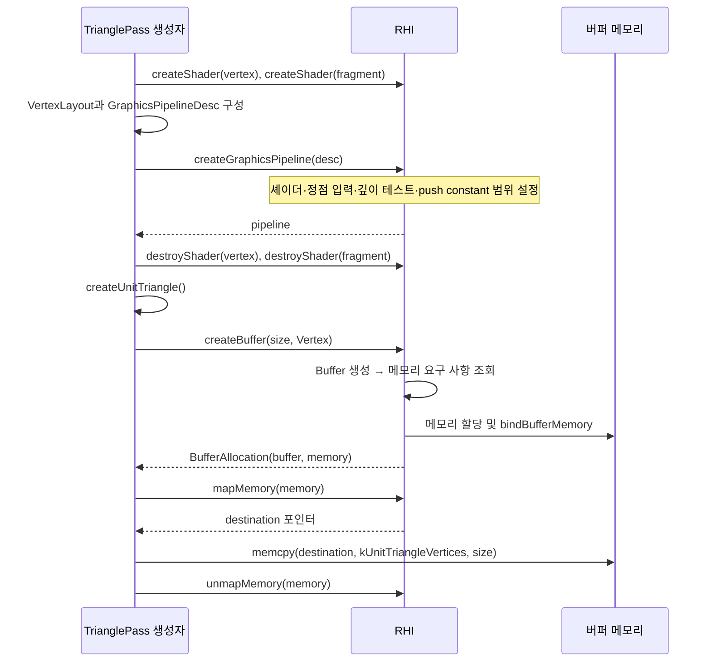
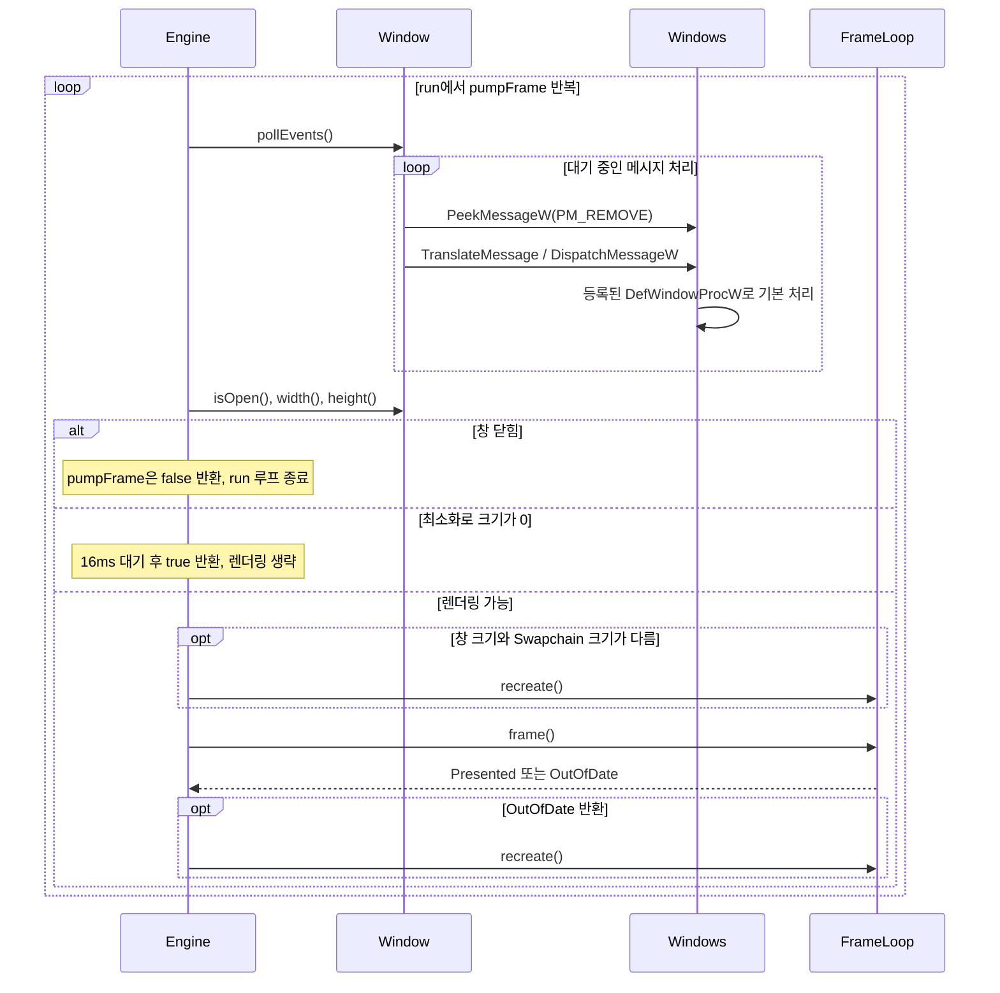
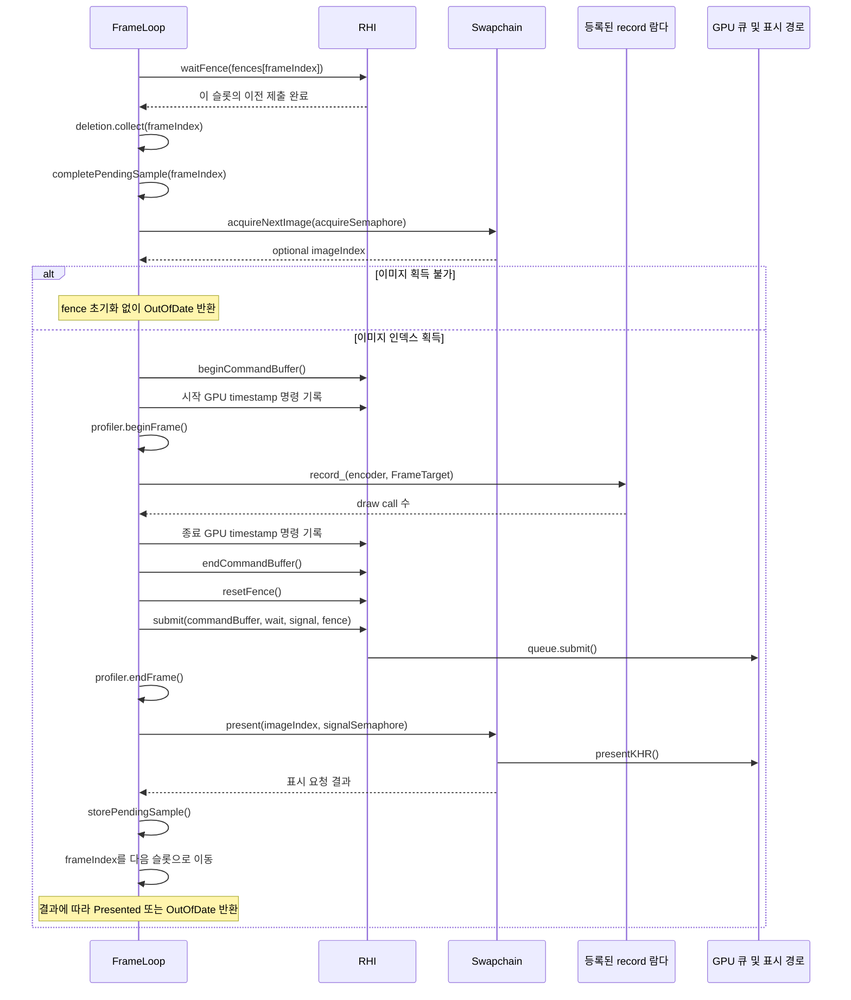
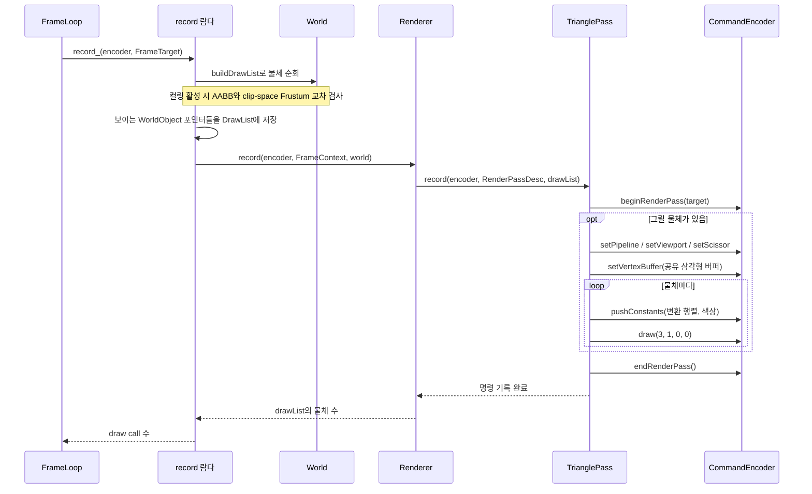
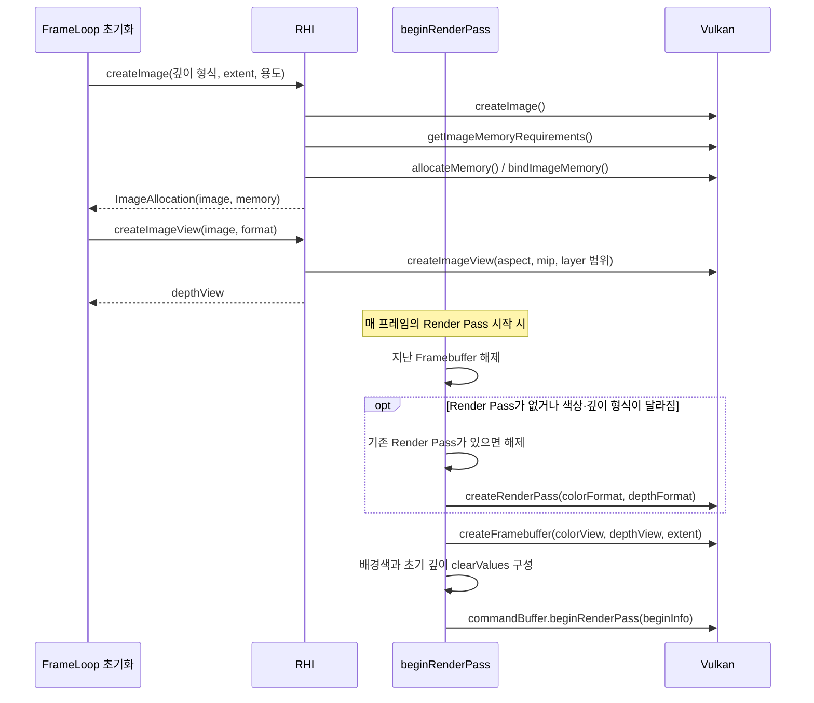
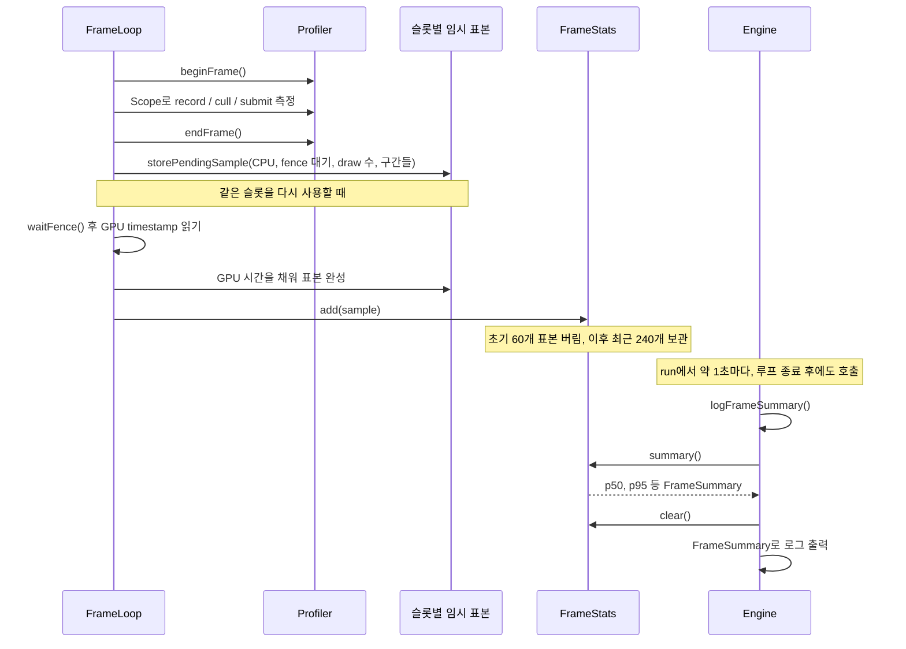
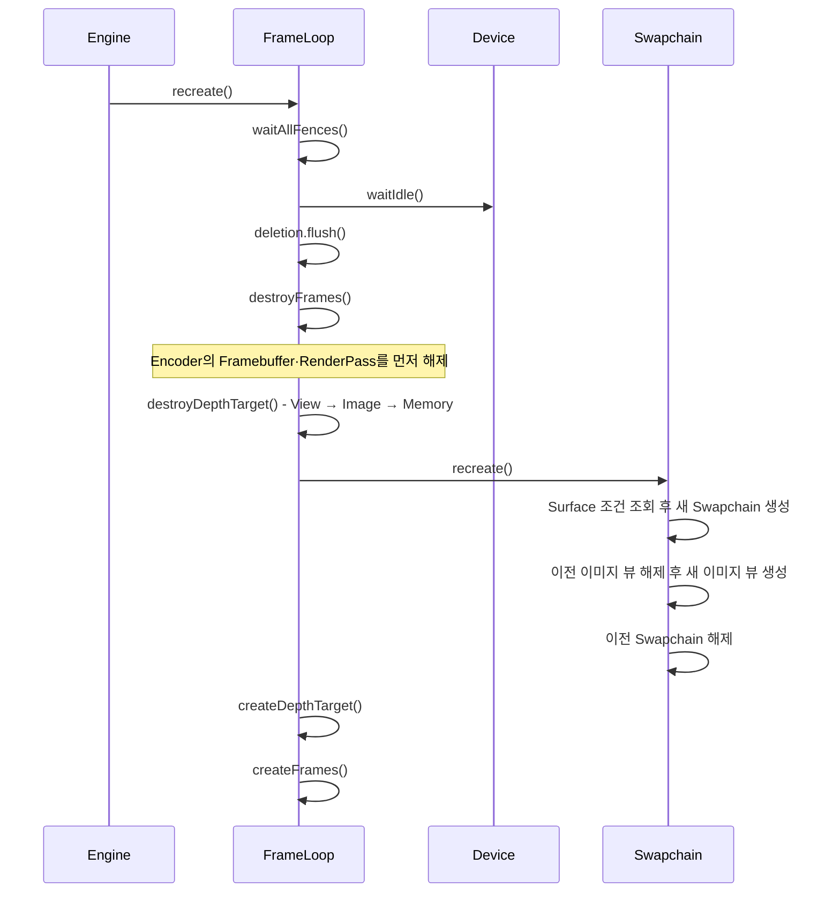

# NXT Engine 실행 시퀀스

현재 Sandbox의 초기화부터 프레임 처리, 정점 데이터 전달, 성능 측정, 종료까지의 실행 흐름을 정리한다.
다이어그램의 `RHI` 호출은 내부에서 Vulkan 백엔드로 연결된다.

## 1. 전체 호출 관계

```text
main()
  ├─ 셰이더 SPIR-V 파일 읽기
  ├─ Engine::create()
  │   ├─ Window 생성
  │   └─ Engine 생성자
  │       ├─ Instance → Surface → Device → Swapchain 생성
  │       ├─ Renderer 생성자 → TrianglePass 생성자
  │       └─ FrameLoop 생성 및 record 람다 등록
  ├─ buildWorld() → WorldObject들의 변환·경계·색상 저장
  ├─ Engine::run()
  │   └─ pumpFrame() 반복
  │       └─ FrameLoop::frame()
  │           └─ record_ 람다
  │               ├─ buildDrawList()
  │               └─ Renderer::record()
  │                   └─ TrianglePass::record()
  └─ Engine 소멸 및 자원 해제
```

핵심 코드: [main.cpp](../../apps/sandbox/main.cpp), [engine.cpp](../../src/nxt/engine/engine.cpp).

## 2. 엔진 초기화



- `Instance`: Vulkan 사용의 시작점이다.
- `Surface`: 운영체제 창과 Vulkan의 화면 표시 경로를 연결한다.
- `Device`: 선택한 GPU를 사용하기 위한 논리 장치다.
- `Swapchain`: 표시할 이미지들을 관리한다.
- `FrameLoop`: 공유 깊이 이미지와 프레임 슬롯별 command buffer, encoder, fence, acquire semaphore, timestamp query pool을 준비한다. Present용 semaphore는 Swapchain 이미지별로 사용한다.

`record` 람다는 등록할 때 실행되지 않는다. `FrameLoop::frame()`이 나중에 호출한다.
캡처한 Renderer·World·DrawList 포인터는 객체를 복사하지 않으며, 참조 대상은 프레임 루프보다 오래 살아야 한다.

## 3. 정점 버퍼와 파이프라인 준비



원본 삼각형은 `(-0.5, -0.5, 0)`, `(0.5, -0.5, 0)`, `(0, 0.5, 0)`의 정점 3개다.
모든 물체가 이 버퍼를 공유하며, 초기화 시 한 번 데이터를 복사한다.

| 설정 | 역할 |
|---|---|
| Vertex buffer binding | 읽을 버퍼를 연결하는 번호 |
| stride | 다음 정점으로 이동할 바이트 수인 `sizeof(MeshVertex)` |
| offset | 정점 구조체에서 `position`이 시작하는 위치 |
| format | 위치를 float 3개로 읽도록 지정 |
| location 0 | 읽은 위치를 셰이더의 `inPosition`에 연결 |

`mapMemory()`는 버퍼 메모리에 CPU가 접근할 주소를 반환한다.
`setVertexBuffer()`는 명령 기록 시 GPU가 읽을 버퍼를 지정한다. 두 작업은 다르다.

핵심 코드: [triangle_pass.cpp](../../src/nxt/renderer/passes/triangle_pass.cpp),
[vulkan_buffer.cpp](../../src/nxt/graphics/backends/vulkan/resource/vulkan_buffer.cpp),
[vulkan_pipeline.cpp](../../src/nxt/graphics/backends/vulkan/resource/vulkan_pipeline.cpp).

## 4. 이벤트 처리와 프레임 진입



`pollEvents()`는 메시지가 없으면 기다리지 않는다.
현재 창의 메시지 처리 함수는 `DefWindowProcW`이며, 닫기 등 Windows 기본 동작을 처리한다.
게임 입력을 엔진 동작으로 연결하는 사용자 정의 WndProc은 현재 이 경로에 없다.

핵심 코드: [engine.cpp](../../src/nxt/engine/engine.cpp),
[win32_window.cpp](../../src/nxt/platform/backends/windows/win32_window.cpp).

## 5. 한 프레임의 명령 기록과 제출



GPU timestamp 명령은 timestamp query pool 지원 시에만 기록한다.
프레임 슬롯의 fence는 처음부터 신호된 상태로 생성되므로 첫 프레임의 대기도 진행할 수 있다.

Acquire와 present의 결과 처리는 다음처럼 다르다. 그 밖의 오류는 `VK_CHECK`로 처리한다.

| 결과 | acquireNextImage | present |
|---|---|---|
| Success | 이미지 인덱스 반환 | true 반환 |
| OutOfDate | nullopt 반환, 제출 없이 프레임 종료 | false 반환, 이미 제출했으므로 다음 슬롯으로 이동 |
| Suboptimal | 경고 후 이미지 인덱스 반환, 렌더링 계속 | false 반환, 다음 슬롯으로 이동하고 재생성 요청 |

| 인덱스 | 의미 |
|---|---|
| `frameIndex` | CPU가 재사용할 프레임 자원 묶음의 번호 |
| `imageIndex` | acquire가 선택한 Swapchain 이미지 번호 |

두 인덱스는 같은 값이라고 가정하면 안 된다.
Acquire semaphore는 프레임 슬롯별, present가 기다릴 semaphore는 Swapchain 이미지별로 선택한다.

| 동기화 객체 | 신호 | 대기 |
|---|---|---|
| Acquire semaphore | 획득한 이미지가 사용 가능해짐 | submit의 색상 출력 단계 |
| Render 완료 semaphore | 제출한 렌더링 작업 완료 | present |
| Fence | 제출한 작업 완료 | CPU의 프레임 슬롯 재사용 |

Acquire 반환은 이미지 인덱스를 얻었다는 뜻이다. 이미지 사용 가능 시점은 semaphore가 연결한다.
`submit()`과 `present()`의 성공 반환은 GPU 작업이나 실제 화면 표시가 끝났다는 뜻이 아니다.
Fence는 present 완료를 보장하지 않는다.

핵심 코드: [frame_loop.cpp](../../src/nxt/engine/frame_loop.cpp),
[vulkan_command_buffer.cpp](../../src/nxt/graphics/backends/vulkan/frame/vulkan_command_buffer.cpp),
[vulkan_swapchain.cpp](../../src/nxt/graphics/backends/vulkan/frame/vulkan_swapchain.cpp).

## 6. 컬링과 물체별 그리기 명령



`FrameTarget`은 프레임 루프가 호출 시 만들어 넘기는 출력 대상 정보다.
람다는 이를 `FrameContext`로 옮기고 DrawList를 추가해 Renderer에 전달한다.
물체가 없어도 패스는 열고 닫아 화면을 초기화한다.

명령 기록과 GPU 실행은 서로 다른 시점이다. 다음 데이터 흐름은 submit 후 GPU가 실행한다.

```text
정점 버퍼 → 위치 속성 location 0 → triangle.vert의 inPosition
WorldObject.transform → pushConstants → object.transform
WorldObject.color     → pushConstants → object.color

triangle.vert
  gl_Position = object.transform * vec4(inPosition, 1.0)
  fragColor = object.color.rgb
       ↓ 정점 처리·클리핑·래스터화 및 보간
triangle.frag
  outColor = vec4(fragColor, 1.0)
       ↓ 색상 출력
색상 이미지에 결과 기록
```

이 그림은 데이터 전달 관계를 나타낸다. 깊이 테스트는 파이프라인에서 활성화돼 있으며,
fragment 셰이더의 색상 출력만으로 모든 fragment가 실제 색상 이미지에 기록되는 것은 아니다.

`buildWorld()`는 `translation({x, y, 0.5}) * scale(s)`를 만든다.
이는 원본 정점 배열을 행렬로 바꾸는 과정이 아니다. 좌표 `(vx, vy, vz)`에 적용하면
`(s*vx+x, s*vy+y, s*vz+0.5)`가 되는 별도의 행렬이다.
현재 데모는 카메라의 view·projection 행렬 없이 결과를 clip 공간에 직접 출력한다.

핵심 코드: [draw_list.cpp](../../src/nxt/renderer/draw_list.cpp),
[renderer.cpp](../../src/nxt/renderer/renderer.cpp),
[triangle.vert](../../shaders/triangle.vert), [triangle.frag](../../shaders/triangle.frag).

## 7. 이미지와 Render Pass 준비



Swapchain의 색상 이미지는 Swapchain 경로에서 확보하고, 깊이 이미지는 `createDepthTarget()`이 별도로 만든다.
Render Pass 시작의 Vulkan 호출은 GPU 명령을 기록한다. Clear도 GPU 실행 시 수행된다.
이 경로는 같은 슬롯의 이전 제출 완료와 command buffer 초기화 이후에 진입한다.

| 객체 | 역할 |
|---|---|
| Memory | 이미지 데이터를 저장할 메모리 |
| Image | 메모리에 연결된 이미지 자원 |
| ImageView | 이미지의 형식과 aspect·밉·레이어 접근 범위를 지정 |
| RenderPass | 부착물 형식, Clear·Store, 레이아웃, Subpass 사용 규칙 |
| Framebuffer | 실제 색상·깊이 ImageView와 크기를 연결 |

색상은 Clear 후 결과를 Store하고, 최종 레이아웃을 PresentSrc로 바꾼다.
깊이는 Clear 후 패스 안에서 사용하고, 패스 종료 후 내용 보존은 요구하지 않는다.
`endRenderPass()`에서 Framebuffer를 즉시 파괴하지 않고, 다음 안전한 재사용 시점까지 유지한다.
파이프라인 생성에 쓰는 호환용 Render Pass와 명령 기록용 Render Pass는 별개 객체이며 구성이 호환돼야 한다.

핵심 코드: [vulkan_image.cpp](../../src/nxt/graphics/backends/vulkan/resource/vulkan_image.cpp),
[vulkan_command_buffer.cpp](../../src/nxt/graphics/backends/vulkan/frame/vulkan_command_buffer.cpp).

## 8. 프레임 성능 표본 수집



- CPU 시간: `frame()` 측정 시작부터 submit 반환 후 측정 시점까지다. Present 호출 시간은 제외한다.
- GPU 시간: command buffer에 기록한 시작·종료 timestamp의 차이다. 미지원 시 해당 표본에 저장된 fence 대기 시간을 근사값으로 쓰고 `gpu~`로 표시한다. 이 대기는 그 프레임의 이전 슬롯 사용을 기다린 시간이므로 실제 GPU 실행 시간과 동일하지 않다.
- `record`에는 `cull`이 포함된다. 두 구간을 합산하면 중복이다.
- `p50`은 중앙값, `p95`는 각 지표의 유효 표본을 정렬한 뒤 `ceil(0.95*m)`번째 값이다. 여기서 `m`은 해당 지표의 표본 수이며, 로그의 `n`과 다를 수 있다. GPU 시간이 0인 표본은 GPU 통계에서 제외한다.
- 로그의 `n`은 clear 이후 완료 표본 수다. 240개를 넘으면 퍼센타일은 최근 240개로 계산한다.
- `draws`는 가장 최근 표본의 draw call 수다.
- `clear()`는 표본을 비우지만 워밍업 진행 상태는 유지한다.

종료 시 `logFrameSummary()`는 이미 `FrameStats`에 들어온 표본만 출력한다.
종료 직전 `pendingSamples_`에 남아 있는 표본을 추가로 완성하거나 수집하지는 않는다.
리사이즈에서도 `destroyFrames()`가 슬롯별 임시 표본을 비우므로 아직 수집되지 않은 표본은 버려진다.

핵심 코드: [profiler.cpp](../../src/nxt/core/diagnostics/profiler.cpp),
[frame_stats.cpp](../../src/nxt/engine/frame_stats.cpp).

## 9. 리사이즈와 종료



Submit fence 대기만으로는 present 완료까지 보장되지 않으므로, 재생성 전에 `waitIdle()`도 수행한다.
Framebuffer가 ImageView를 참조하므로 프레임 자원을 먼저 없애고 이미지 뷰를 나중에 없앤다.
위 다이어그램은 Surface 크기가 0이 아닌 정상 재생성 경로다. 크기가 0이면
`VulkanSwapchain::recreate()`는 이전 Swapchain을 유지하고 반환한다.
바깥 `FrameLoop::recreate()`는 계속 `createDepthTarget()`과 `createFrames()`를 호출하므로,
전체 재생성이 중단되는 것으로 해석하면 안 된다.

종료는 `Engine::~Engine()`에서 다음 순서로 진행한다.

```text
FrameLoop 해제
  → 모든 submit fence 대기 + Device waitIdle
  → 지연 삭제 목록 처리
  → 프레임 자원 해제
  → 깊이 View / Image / Memory 해제
Renderer 해제
  → TrianglePass의 정점 버퍼·메모리와 파이프라인·레이아웃 해제
Swapchain 해제
Device 해제
Surface 해제
Instance 해제
Window 해제
```

프레임 루프에 저장된 람다가 Renderer·World를 참조하므로 FrameLoop가 먼저 사라진다.
GPU 사용 종료를 확인한 뒤 각 자원을 해제하는 것이 공통 원칙이다.
