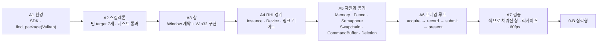
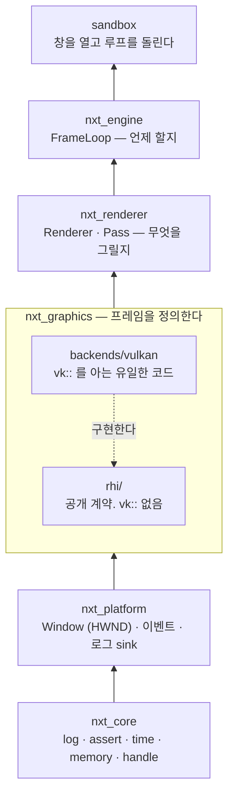
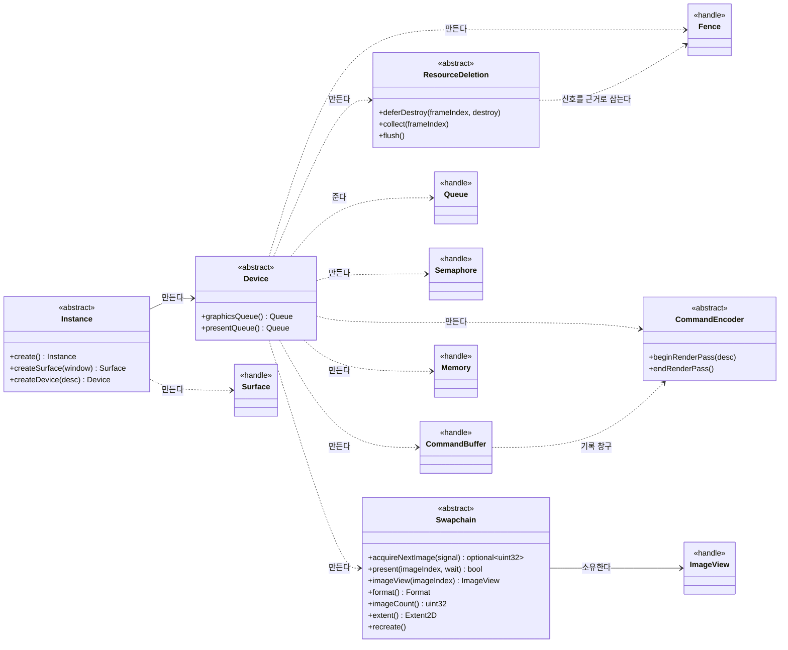
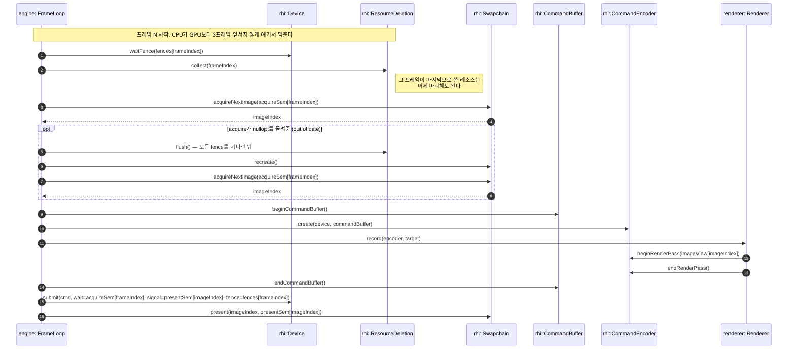
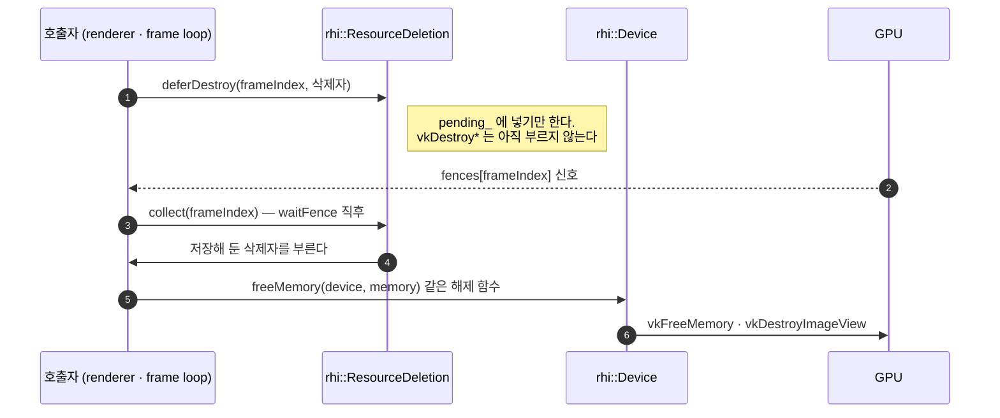
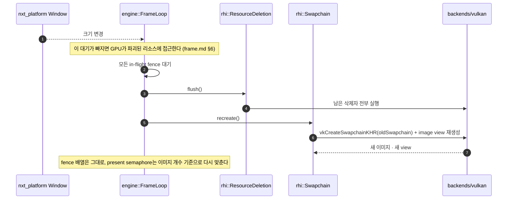

# Phase 0 — 삼각형

> 목표: **창에 삼각형 하나를 띄운다.**
>
> 산출물은 삼각형이 아니라 **"이 아키텍처로 엔진이 간다"는 증거**다.

---

## 아키텍처 지도 — 먼저 읽을 것

이 문서는 "삼각형을 그리는 방법"이 아니라 **GPU를 다루는 골격을 세우는 순서**다.
그래서 코드를 읽기 전에 네 가지를 그림으로 먼저 고정한다.

| 그림 | 답하는 질문 | 결정하는 것 |
|---|---|---|
| 계층 구조 | 누가 무엇을 아는가 | 경계. 한 번 넘으면 되돌리기 비싸다 |
| RHI 타입 지도 | 어떤 객체가 있고 누가 만드는가 | 소유권과 수명 |
| 프레임 시퀀스 | 한 프레임에 무슨 일이 순서대로 일어나는가 | GPU 버그의 대부분이 여기서 갈린다 |
| 지연 파괴 · 리사이즈 | destroy는 왜 즉시 일어나지 않는가 | use-after-free를 막는 유일한 방법 |

### 1. A1 → A7 진행 지도



각 단계는 앞 단계의 산출물만 쓴다. A5까지는 **아무도 프레임을 돌리지 않으므로**
`nxt_graphics`가 STATIC 라이브러리인 채로 남고, 심볼이 정의되지 않아도 빌드가 통과한다.
그래서 각 단계마다 임시 TU로 링크 게이트를 돌린다 — "빌드가 됐다"와 "쓸 수 있다"는 다르다.
A6에서 처음으로 전부 이어지고, A7에서 비로소 창에 무언가가 나온다.

### 2. 계층 구조 — 아는 것의 경계



화살표는 "의존한다"이고 위로 갈수록 응용에 가깝다. **금지된 화살표가 두 개다.**
`renderer → backends/vulkan`(렌더러가 Vulkan을 직접 만짐)과 `rhi/ → vk::`(계약이 API에
묶임)다. 둘 중 하나만 생겨도 Phase 3의 render graph를 넣을 때 전부 뜯어야 한다.
문서 끝의 `grep` 검증 항목이 그 둘을 기계적으로 확인한다.

`graphics`는 "GPU에 무엇을 시킬지"를 알고, `engine`은 "언제"만 안다. 두 책임을 가르는
기준은 `present`다 — 화면에 내보내는 순간이 프레임의 끝이고, 그 시점을 아는 쪽은
엔진이다 (frame.md §2).

### 3. RHI 타입 지도 — 두 가지 모양



**모양이 두 가지인 이유는 딱 하나다 — 상태를 들고 있느냐.**

- `<<handle>>` (값 핸들 + 자유 함수): 핸들 하나로 끝난다. 배열로 들고 다니기 쉽다.
- `<<abstract>>` (추상 클래스 + factory): 핸들 외에 자체 상태가 있다. `Swapchain`은 픽셀
  형식·이미지 개수·view 배열을, `CommandEncoder`는 render pass를, `ResourceDeletion`은
  대기 목록을 들고 있다. 값으로 복사하면 그 상태가 갈라지므로 복사를 막는다.

계약과 구현의 대응은 파일 이름이 같다.

```text
rhi/ (계약 — vk:: 없음)              backends/vulkan/ (구현 — vk:: 는 여기서만)
core/instance.hpp                    core/vulkan_instance.cpp
core/device.hpp                      core/vulkan_device.cpp
resource/memory.hpp                  resource/vulkan_memory.cpp
frame/fence.hpp                      frame/vulkan_fence.cpp
frame/semaphore.hpp                  frame/vulkan_semaphore.cpp
frame/swapchain.hpp                  frame/vulkan_swapchain.cpp
frame/command_buffer.hpp             frame/vulkan_command_buffer.cpp
frame/resource_deletion.hpp          frame/vulkan_resource_deletion.cpp
```

`ResourceDeletion`의 구현만 `vk::`를 한 줄도 쓰지 않는다. 이 타입이 하는 일은 Vulkan
호출이 아니라 **호출 시점을 정하는 것**이기 때문이다. 그래서 리소스 종류가 늘어도 이
파일은 바뀌지 않는다.

### 4. 한 프레임의 시퀀스 — A6가 만드는 것



읽을 때 주목할 지점이 넷이다.

1. **맨 앞의 `waitFence`가 백프레시다.** 없으면 CPU가 큐를 무한히 쌓는다. 여기서 기다리는
   것은 3프레임 전에 제출한 프레임이므로, 그 프레임이 쓴 리소스는 지금 안전하다.
2. **`collect`가 `waitFence` 바로 뒤에 온다.** 이 순서가 "더는 쓰지 않는다"의 근거다.
   순서를 바꾸면 파괴 직전에 GPU가 여전히 쓰는 리소스를 지운다.
3. **`record`가 encoder만 받는 것이 경계다.** renderer는 `Device`도 `CommandBuffer`도 받지
   않으므로 GPU 상태를 직접 다룰 수 없다. "렌더러는 Vulkan을 모른다"가 관례가 아니라
   타입으로 강제된다 (frame.md §3).
4. **semaphore 두 개의 색인이 다르다.** acquire용은 프레임 인덱스, present용은 **이미지
   인덱스**다. `vkQueuePresentKHR`는 fence를 신호하지 않으므로, 이미지 인덱스로 색인한
   semaphore만이 "그 이미지를 쓴 이전 present가 끝났다"를 보장한다 (frame.md §5).

### 5. 리소스 지연 파괴 — A5의 마지막 조각



**즉시 파괴가 왜 위험한가.** 트리플 버퍼링이면 GPU가 세 프레임을 동시에 처리한다. 프레임
10을 CPU가 기록하는 동안 GPU는 프레임 8을 그리고 있을 수 있다. 그때 프레임 8이 쓰는 view를
destroy하면 use-after-free다. 재현이 어렵고 검증 레이어에서만 잡히는 종류의 버그다.

**이 타입이 없으면 그 판단이 호출부마다 흩어진다.** 지금은 "마지막으로 쓴 프레임 인덱스"만
넘기면 나머지는 fence가 결정한다. 삽입 순서가 곧 파괴 순서이므로 `Pipeline → Buffer` 같은
의존성 순서도 타입을 늘리지 않고 표현된다 (frame.md §9).

### 6. 리사이즈 — A7에서 이 경로가 검증된다



리사이즈를 빠르게 반복하면 이 경로가 초당 수십 번 돈다. 그래서 A7 검증 항목에
"리사이즈해도 깨지지 않는다"가 들어 있다. 이 시퀀스를 지키지 않으면 창을 흔드는 것만으로
크래시가 난다.

---

## 현재 상태

| 단계 | 상태 |
|---|---|
| **A1 환경** | 🟢 완료. SDK 1.4.363.0 설치, `find_package(Vulkan)` 동작 확인 |
| **A2 스켈레톤 배선** | 🟢 완료. Vulkan 소스 0개로 target 7개 생성, 빌드·테스트 통과 |
| **A3 창** | 🟢 완료. `Window` interface + `Win32Window` (HWND) |
| **A4 RHI 경계와 수명** | 🟢 완료. `rhi/` 공개 헤더 + `instance`·`device` 백엔드, 링크 게이트 0, 헤더 단독 `/W4 /WX` 통과. Linux는 보류 |
| **A5 RHI 자원과 동기** | 🟢 완료. 공개 헤더 6종 + 백엔드 6종(`memory`·`fence`·`semaphore`·`swapchain`·`command_buffer`·`resource_deletion`). 링크 게이트 통과. GPU 런타임 확인은 A7에서 |
| **A6 프레임 루프** | 🟢 완료. `engine/frame_loop.{hpp,cpp}`. 레인 자원 소유와 out-of-date 반환 계약, 링크 게이트 통과. GPU 실행은 A7에서 |
| **A7 0-A 검증** | 🔴 A6는 끝났다. 이제 실제 GPU에서 확인한다 |
| **B 삼각형** | 🔴 미착수 |
| **C 계층 배선** | 🔴 미착수 |

Vulkan 런타임은 준비돼 있다 (RTX 4060, API 1.4.351).

### 이미 되어 있어 재사용되는 것

| 파일 | Phase 0에서의 용도 |
|---|---|
| `core/diagnostics/log.{hpp,cpp}` | Vulkan 디버그 메시지 출력. `LogSubsystem::Vulkan`이 이미 있음 |
| `core/diagnostics/assert.{hpp,cpp}` | `VK_CHECK`의 기반 |
| `core/time/{time,timer}.hpp` | 프레임 타이밍, CPU/GPU 분리 측정 |
| `platform/.../win32_console_log_sink.*` | 콘솔 출력 |
| `platform/.../win32_file_log_sink.*` | 파일 출력 |

### 만들어야 하는 것

| 파일 | 상태 |
|---|---|
| `core/memory/{arena,pool,allocator}.hpp` | 구현됨. **Phase 0에 소비자 없음** — Phase 1 첫 사용 |
| `core/handle/*.hpp` | 구현됨. Phase 2 애셋 핸들로 사용 |

---

## 의존 방향

```text
nxt_core → nxt_platform → nxt_graphics → nxt_renderer → nxt_engine
                                              ↓
                                    backends/vulkan  (Vulkan을 아는 곳은 여기뿐)
```

역방향 의존이 없어야 한다. 위의「계층 구조」그림과 같은 방향이고, 그 화살표가 모두 실제
코드 경로가 되면 Phase 0 끝이다.

설계 근거는 [`../design/rhi.md`](../design/rhi.md),
[`../design/frame.md`](../design/frame.md),
[`../design/scene_world.md`](../design/scene_world.md).

---

# 0-A — 색으로만 채워지는 창

```text
Instance → Surface → Device → Memory → Swapchain → CommandBuffer → present
```

파이프라인·메시·셰이더를 빼고 GPU 스파인만 최소로 만든다.

## A1. 환경

- [x] Vulkan SDK 설치 — 1.4.363.0
- [x] `find_package(Vulkan REQUIRED)` 연결
- [x] include · `vulkan-1.lib` · glslang 경로 탐지 확인
- [x] GPU 초기화 1회 확인 — SDK 샘플로

## A2. 스켈레톤 배선 (C++ 코드 없음)

- [x] `src/nxt/CMakeLists.txt`에 모듈 7개 등록
- [x] `src/nxt/math/` 생성 — `nxt_math` INTERFACE 타깃
- [x] `graphics` `renderer` `engine` `assets` CMakeLists 작성
- [x] `graphics/backends/vulkan/CMakeLists.txt` 작성
- [x] `platform/CMakeLists.txt` — `.hpp`를 `add_library` 소스에서 빼고 `FILE_SET`으로
- [x] `platform/backends/windows` — `win32_window.hpp`를 공개 계약에서 제외
- [x] `platform/backends` — `if(WIN32)` 가드
- [x] `apps/sandbox` — `nxt_core` 명시적 링크
- [x] 죽은 placeholder CMakeLists 13개 삭제
- [x] `cmake/CompileShaders.cmake` 추가
- [x] **검증: Vulkan 소스 없이 target 7개 생성, 빌드 통과, 테스트 2개 통과**

생성된 타깃:

```text
nxt_core  nxt_math  nxt_platform  nxt_graphics  nxt_renderer  nxt_engine  nxt_assets  sandbox
```

A2 시점에 `nxt_graphics`는 소스가 없어 INTERFACE였다. A4에서 첫 `.cpp`가 생기며 STATIC으로 전환했다.

### CMake 규칙

```text
모듈당 CMakeLists 하나에 모든 헤더를 FILE_SET으로 등록한다.
백엔드만 예외로 backends/<os>/가 자체 CMakeLists를 가진다.
FILE_SET 이름이 다르면 TYPE HEADERS를 명시하고 소문자로 쓴다.
공개 헤더는 FILE_SET HEADERS, 비공개는 별도 이름으로 PRIVATE.
```

## A3. 창

- [x] `platform/window/window.hpp` — interface
- [x] `platform/backends/windows/win32_window.{hpp,cpp}` — HWND

```cpp
class Window {
public:
    virtual ~Window() = default;
    virtual void* nativeHandle() const noexcept = 0;  // HWND
    virtual bool isOpen() const noexcept = 0;
    virtual void pollEvents() = 0;
};
```

platform은 `HWND`까지만 준다. `VkSurfaceKHR`를 만드는 일은 graphics의 몫이다.

## A4. RHI 경계와 수명

`rhi/` 경계를 확정하고, 창 → surface → device로 이어지는 **수명 계층**을 백엔드에
구현한다. `Instance::create()` 경로가 링크되면 끝난다. GPU 리소스와 프레임 동기는
A5다 — 여기서는 만들지 않는다.

플랫폼은 **Win32만 대상**이다. Linux surface 백엔드는 미루고 자리만 남긴다 (아래
"백엔드 구현" 참조).

구조와 CMake 배선 (완료)

- [x] `graphics/runtime/` 삭제. `rhi/`로 통합한다 (아래 "착수 시 결정할 것" 참조)
- [x] `nxt_graphics` INTERFACE → STATIC
- [x] Vulkan include/link를 `INTERFACE` → `SYSTEM PRIVATE`로 전환
- [x] `nxt_core` · `nxt_platform` 링크, `/W4`, `VULKAN_HPP_DISPATCH_LOADER_DYNAMIC=1`
- [x] `FILE_SET HEADERS`(공개) + `FILE_SET backend_headers`(백엔드) 배선
- [x] **검증: `nxt_graphics.vcxproj` 생성. `renderer`·`engine`·`sandbox`에 Vulkan include 경로 없음**
- [x] `rhi/` · `backends/vulkan/`을 `common` · `core` · `frame` · `resource` 4분류로 정리
- [x] 엔진 이름·버전을 루트 `project()`에서 주입 — `NXT_PROJECT_NAME` · `NXT_PROJECT_VERSION_{MAJOR,MINOR,PATCH}`

공개 헤더 (`src/nxt/graphics/rhi/`)

파일이 늘어나므로 `backends/vulkan/`과 같은 4분류로 나눈다. `rhi.hpp`만 최상위에 둔다.

```text
common/    어휘 — 모든 헤더가 공유하는 토대
core/      프로그램 수명 — 인스턴스 · 디바이스
frame/     프레임 실행과 동기
resource/  GPU 리소스
```

- [x] `rhi.hpp` — umbrella. 공개 헤더를 모으는 입구
- [x] `common/handle.hpp` — `OpaqueHandle`, `ResourceHandle<Tag>`
- [x] `common/enums.hpp` — Format, Topology, PresentMode, LoadOp, StoreOp, IndexType, BufferUsage
- [x] `core/instance.hpp` — Instance, Surface
- [x] `core/device.hpp` — Device, Queue

`resource/` · `frame/` 헤더는 A5다.

**검증 완료: 헤더 단독 컴파일.** A4를 닫으며 `rhi.hpp`를 포함한 공개 헤더 5개를
각각 단독 TU로 `/W4 /WX` 컴파일해 자기 완결성을 확인했다. 그 전까지 이 헤더들은
`backends/vulkan/`이 include할 때만 컴파일되고 있었다.

### RHI 타입은 두 패턴을 함께 쓴다

하나로 통일하지 않는다. 상태의 성격이 다르다.

```text
값 핸들 + 자유 함수       Fence  Semaphore  Memory  CommandBuffer
                         리소스 하나가 핸들 하나면 충분하다

추상 클래스 + factory     Instance  Device  Swapchain
                         vk 핸들 외에 자체 상태가 있고 해제 순서가 있다
                         Swapchain은 format·imageCount·view 배열을 들고 있다
```

```cpp
using Fence = ResourceHandle<FenceTag>;          // 값 타입
void waitFence(const Device& device, const Fence& fence);

class Swapchain {                                 // 다형성
public:
    static std::unique_ptr<Swapchain> create(const SwapchainDesc&);
    virtual ~Swapchain() = default;
    virtual ImageView imageView(std::uint32_t index) const = 0;
};
```

**`Instance`·`Device`·`Swapchain`의 `create()`는 rhi/에 선언만 하고 backend가 정의한다.**
그래서 factory를 RHI 밖에서 작성할 수 없다 — 규칙이 관례가 아니라 빌드 구조로 강제된다.

`Device`의 생성은 `Instance::createDevice()`가 맡는다. Instance가 Device를 만드는
유일한 지점이기 때문이다.

Fence를 `unique_ptr`로 만들지 않는 이유는 `frame.md` §5의 두 배열 때문이다.

```text
acquire_semaphores[framesInFlight]        ← 프레임 인덱스
submit_semaphores[swapchainImageCount]    ← 이미지 인덱스
```

`std::vector<std::unique_ptr<Semaphore>>`를 색인해야 하면 이 규칙이 성에 안 맞는다.

### 핸들은 `nxt_core::handle::Handle`를 상속하지 않는다

| | `core::handle::Handle<Tag>` | `rhi::ResourceHandle<Tag>` |
|---|---|---|
| 저장 | `{index: u32, generation: u32}` | `value: u64` |
| 짝 | `HandleManager` 필수 | 없음 |
| 세대 관리 | 직접 함 | Vulkan이 함 |
| 쓰임새 | Phase 2 애셋 (`scene_world.md` §7) | Phase 0 GPU 리소스 |

Vulkan은 `VkImageView`와 `VkBuffer`를 다른 타입으로 선언하지만 실제로는 둘 다 64비트 값이다.
그 값들을 그대로 다루면 실수를 컴파일 시점에 못 잡는다. 태그로 종류를 구분해 막는다.

### 핸들 헤더는 어떤 TU에서도 include되지 않는다

`FILE_SET HEADERS`는 IDE에 파일로 노출만 하고 **컴파일하지 않는다.** `.cpp` 하나가
헤더를 include하기 전까지는 그 안에 문법 오류가 있어도 빌드가 통과한다.

`A4` · `A5` 검증은 임시 TU로 헤더를 단독 컴파일해서 한다. `/W4 /WX`로 올린다.

```powershell
cl /std:c++20 /W4 /WX /utf-8 /permissive- /c /I "%SRC%" rhi_check.cpp
```

헤더는 자기 완결이어야 한다 (`CODING_RULES.md` §5). 필요한 헤더는 직접 include하고
transitive include에 기대지 않는다.

시그니처까지 고정하려면 함수 포인터에 대입한다. `const&`가 빠졌다고 컴파일은 된다.

```cpp
static_assert(std::is_same_v<decltype(&waitFence), void (*)(const Device&, const Fence&)>);
```

**검증 코드의 기대값은 헤더에서 복사하지 않는다.** 비트 값을 직접 세어 고정한다.

```cpp
constexpr BufferUsage kVertices = BufferUsage::Vertex | BufferUsage::TransferDst;
static_assert(static_cast<std::uint32_t>(kVertices) == 33u);   // Vertex=1<<0, TransferDst=1<<5
```

`TransferDst`는 `1u << 5`라서 32다. `1u << 4`(TransferSrc)와 헷갈리기 쉽고,
기대값을 잘못 쓰면 컴파일 자체가 아니라 검증이 조용히 틀어진다.

MSVC 콘솔에서 한국어 오류 메시지가 깨지면 오류 코드를 함께 본다. `static_assert`가
실패한 줄과 다른 줄에서 그 진짜 원인이 보이는 경우가 있다.

백엔드 구현 (`src/nxt/graphics/backends/vulkan/`)

`rhi/`와 같은 4분류로 나눈다.

```text
common/    vk:: 경계 — vulkan.hpp를 아는 유일한 파일이 여기 있다
core/      프로그램 수명 — 인스턴스 · 디바이스
frame/     프레임 실행과 동기
resource/  GPU 리소스
```

- [x] `common/vulkan_types.hpp` — vk:: 타입이 존재하는 유일한 파일
- [x] `common/vulkan_check.hpp` — `VK_CHECK`
- [x] `core/vulkan_instance.cpp` (+ `core/vulkan_instance_win32.cpp`) — 플랫폼 분기
- [x] `core/vulkan_device.cpp` — 물리 디바이스·queue family 선택, 논리 디바이스 생성

`core/vulkan_instance_linux.cpp`는 **보류**다. 지금은 Win32만 대상이라 XCB 구현을
미룬다 — 빈 파일과 CMake의 `UNIX` 분기는 나중에 붙일 자리로만 남긴다.

`resource/` · `frame/` 구현은 A5다.

**링크 게이트.** `nxt_graphics`는 STATIC이라 아무도 참조하지 않는 오브젝트를 최종 링크에
끌어오지 않는다. 그래서 미정의 심볼은 라이브러리 빌드만으로는 드러나지 않는다.
`rhi::Instance::create()`를 실제로 부르는 임시 TU를 만들어 붙여야 보인다. A4를 닫으며
이 게이트가 0이 됐다 — 창 → `Instance::create()` → `createSurface()` → `createDevice()`
경로가 끝에서 끝까지 링크된다. `frame/` · `resource/` 심볼은 A5에서 채우고, 그때도
같은 방법으로 각 심볼을 참조해 확인한다.

`vulkan_loader`를 직접 작성하지 않는다. `find_package(Vulkan)`이 준 `Vulkan::Vulkan`을
링크하고 Vulkan-Hpp의 동적 디스패처를 쓴다. 근거는
[`../design/rhi.md` §6](../design/rhi.md) — 이전 문서의 "직접 로드"는 철회했다.

**`vulkan_types.hpp`가 enums를 소비하는 지점이다.** `rhi::Format` ↔ `VkFormat` 매핑을
여기에 둔다. 배열 조회 대신 `switch`를 쓴다 — `/W4`가 `case` 누락을 잡아주므로,
나중에 열거형을 늘렸는데 매핑을 빠뜨리면 컴파일 시점에 드러난다.

**RHI 밖으로 `vk::`가 새지 않는지 그 자체로 검증되는 지점이다.** 이 파일이
`vulkan/vulkan.hpp`를 처음 include하고 `ResourceHandle<Tag>`를 처음 역변환한다.

`vulkan_types.hpp`만 `vulkan/vulkan.hpp`를 include한다. 다른 어떤 파일도 직접 하지 않는다.

**64비트에서 Vulkan 핸들은 모두 포인터 타입이다.** `VK_USE_64_BIT_PTR_DEFINES == 1`
이면 dispatchable(Instance · Device · Queue)과 non-dispatchable(Surface · Image · Buffer)의
구분 없이 `struct X_T*`다 (`vulkan_core.h`). 그래서 `static_cast`로는 64비트 정수와
오갈 수 없고, `toVkHandle` · `fromVkHandle` 한 쌍이 `reinterpret_cast`를 쓴다.
종류별로 변환 함수를 나누지 않는다 — 64비트에서 둘은 같은 코드가 된다.

**동적 디스패처는 정의가 필요한 extern 변수다.** `VULKAN_HPP_DEFAULT_DISPATCHER`가
가리키는 객체는 `VULKAN_HPP_DEFAULT_DISPATCH_LOADER_DYNAMIC_STORAGE`를 한 TU에서
한 번 펼쳐야 생긴다 (`vulkan_hpp_macros.hpp`). 그 자리는 디스패처를 초기화하는
`vulkan_instance.cpp`가 맡는다.

**`VK_CHECK`는 `vk::Result`만 받는다.** 값이 있는 호출은 `ResultValue<T>`를 돌려주므로
먼저 받아 `.result`를 넘기고 `.value`로 값을 꺼낸다. 담긴 값을 버리지 않게 하려는
의도다 (`VULKAN_HPP_NO_EXCEPTIONS`의 enhanced 함수 반환 형태).

```cpp
const auto created = vk::createInstance(createInfo);
VK_CHECK(created.result);
vk::Instance instance = created.value;
```

## A5. RHI 자원과 동기

GPU 리소스(`resource/`)와 프레임 동기(`frame/`)를 붙인다. 이 단계가 끝나면 0-A에
필요한 객체를 전부 만들 수 있다.

`frame/` 계열은 A5 시점에 아무도 호출하지 않는다. 그래서 링크 검증은 각 심볼을
참조하는 임시 TU로 한다 — A4의 "링크 게이트"와 같은 방법이다.

공개 헤더 (`src/nxt/graphics/rhi/`)

- [x] `resource/memory.hpp` — GPU 메모리, `MemoryProperty`, allocate·free·map·unmap
- [x] `resource/image.hpp` — ImageView (`Image` 자체는 B4)
- [x] `frame/fence.hpp` — create·destroy·wait·reset·isSignaled
- [x] `frame/semaphore.hpp` — Semaphore (`frame.md` §5가 요구. 처음 스파인 목록에 누락돼 있었다)
- [x] `frame/swapchain.hpp`
- [x] `frame/command_buffer.hpp` — CommandBuffer, CommandEncoder, RenderPassDesc
- [x] `frame/resource_deletion.hpp` — fence 기반 지연 파괴

### Semaphore에 단독 대기 연산이 없다

Vulkan의 semaphore 대기는 항상 submit·present의 wait 목록에 넣어서 한다. 독립된
"semaphore 대기"가 존재하지 않는다. CPU가 기다리려면 fence를 쓴다.

그래서 `semaphore.hpp`는 생성과 해제만 가진다. device 전체를 기다리는 일도
fence로 해결한다 (`frame.md` §6 리사이즈 2번도 fence 대기). `rhi.md` §8이
"Pipeline barrier는 submit의 암묵적 대기로 충분하다"고 한 이유와 같다.

`waitFence`에 timeout 인자를 넣지 않은 것도 같은 이유다. `frame.md` §5가 "무한정
기다리는 쪽이 옳다고 가정한다"고 명시했다. 호출자가 없는 timeout 파라미터는
`CODING_RULES.md` §10이 금지하는 요구사항 없는 추상화다.

### GPU 객체는 디바이스를 명시적으로 받는다

`fence`·`semaphore`·`memory`의 모든 연산은 첫 인자가 `const Device&`다.

```cpp
Fence createFence(const Device& device);
Memory allocateMemory(const Device& device, std::uint64_t size, MemoryProperty required);
```

이유는 Vulkan의 규약 그대로다. GPU 객체의 생성과 소멸은 전부 디바이스가 행위한다.

```text
vkAllocateMemory(device, ...)      vkCreateFence(device, ...)
vkMapMemory(device, ...)           vkWaitForFences(device, ...)
vkFreeMemory(device, ...)           vkResetFences(device, ...)
```

디바이스를 인자로 받지 않으면 백엔드가 숨은 상태를 들고 있어야 하고, 그 순간
"누가 생성·소유·파괴하는가"를 코드만으로 알 수 없게 된다 (`CODING_RULES.md` §9).

`Instance`이 만드는 것은 `Surface`와 `Device` 둘뿐이고, 나머지는 전부 `Device`가
만든다. 이 규칙은 `instance.hpp`부터 계속 적용된다.

`class Device;` 전방선언만으로 충분하므로 `fence.hpp`·`semaphore.hpp`·`memory.hpp`은
`device.hpp`를 include하지 않는다. 세 파일은 서로에게도 의존하지 않는 리프다.

### Command pool은 디바이스가 하나 소유한다

`CommandBuffer` 핸들은 값 하나라 pool을 품을 수 없다. 백엔드가 pool을 대신 들고
있으면 "누가 소유·파괴하는가"가 코드에 드러나지 않으므로(§9) 디바이스가 갖는다.
스레드도 큐도 하나뿐이라 pool을 나눌 이유가 없고, 디바이스보다 먼저 파괴한다.

`CommandEncoder`는 `create()`가 `unique_ptr`로 돌려준다. render pass와 framebuffer를
begin/end 사이에 들고 있어야 하는데 `vk::` 타입은 `rhi/` 헤더에 올 수 없기 때문에
`Swapchain`과 같은 이유로 자체 상태를 갖는다. 이 중 render pass는 형식에만 묶여
재사용하고, framebuffer는 특정 image view에 묶여 swapchain 재생성마다 무효가 되므로
pass마다 만들고 버린다.

### Memory는 CPU 할당자와 대체 관계가 아니다

```text
SystemAllocator  →  _aligned_malloc / std::aligned_alloc        →  CPU 가상 메모리
rhi::Memory      →  vkAllocateMemory(memoryTypeBits) + vkMapMemory  →  GPU 메모리
```

`MemoryProperty`로 요구한 성질을 모두 가진 타입을 GPU가 찾지 못하면 할당이 실패한다.
어떤 GPU는 `HostVisible`과 `DeviceLocal`을 동시에 주지 않는다.

Phase 0의 업로드 버퍼는 아래 조합이면 충분하다. `HostCoherent` 덕분에 명시적 flush가
없다 — 그 성질이 없으면 CPU 쓰기가 GPU에 반영되지 않는다.

```cpp
MemoryProperty::HostVisible | MemoryProperty::HostCoherent   // 메모리 성질
BufferUsage::TransferDst                                      // 버퍼 용도
```

`HostVisible`은 PCIe를 지나 CPU가 접근할 수 있게 하고, `HostCoherent`은 그 쓰기를
별도 신호 없이 GPU가 보게 만든다. 할당은 한두 번뿐이라 allocator 계층은 만들지
않는다. VMA는 Phase 2에서 검토한다.

### `ImageView`만 먼저 넣는 이유

B4가 깊이 버퍼를 앞당긴 것과 같은 논리다.

> **깊이 버퍼를 여기서 넣는다.** 삼각형 하나에는 시각적으로 필요 없지만, 나중에 넣으면
> 다섯 곳을 다시 건드린다.

스왑체인 이미지는 0-A부터 render pass의 color attachment 자리에 view가 들어가야 한다.
`image.hpp`를 A5에서 만들고 `ImageView`만 넣은 뒤, B4에서 `Image`를 더한다.

백엔드 구현 (`src/nxt/graphics/backends/vulkan/`)

- [x] `resource/vulkan_memory.cpp`
- [x] `frame/vulkan_fence.cpp` · `frame/vulkan_semaphore.cpp`
- [x] `frame/vulkan_swapchain.cpp`
- [x] `frame/vulkan_command_buffer.cpp`
- [x] `frame/vulkan_resource_deletion.cpp`

**`memory.hpp`가 별도 계층인 이유.** `SystemAllocator`로 대체되지 않는다.

```text
SystemAllocator  →  _aligned_malloc / std::aligned_alloc        →  CPU 가상 메모리
rhi::Memory      →  vkAllocateMemory(memoryTypeBits) + vkMapMemory  →  GPU 메모리
```

memory type bits(`DEVICE_LOCAL` `HOST_VISIBLE` `HOST_COHERENT` `HOST_CACHED`)
와 mapping을 다뤄야 한다. `SystemAllocator`를 감싸도 둘 다 얻을 수 없다. **대체 관계가 아니다.**

필요한 버퍼가 1~2개이므로 allocator abstraction은 만들지 않는다. 할당이 많아지는 Phase 2에서 VMA를 검토한다.

## A6. 프레임 루프

- [x] `engine/frame_loop.{hpp,cpp}` — acquire → record → submit → present
- [x] 레인 자원(fence · semaphore · command buffer) 소유와 out-of-date 반환 계약
- [x] Debug 빌드 `/W4` 경고 0, 링크 게이트(`/W4 /WX /MDd`), clang-format, ctest 2/2 통과

설계 고정 사항 ([`frame.md`](../design/frame.md))

```text
minImageCount = 3        트리플 버퍼링. 더블은 VSync를 놓치면 30fps로 떨어진다
present mode  = FIFO     MAILBOX는 입력 지연이 필요할 때만
present semaphore의 색인은 프레임 인덱스가 아니라 이미지 인덱스
destroy()는 지연 목록에 넣고, 그 리소스를 마지막으로 쓴 프레임의 fence가
  신호된 뒤에 실제 파괴한다
파괴 순서는 Pipeline → Buffer/Image
```

구현이 정한 것 세 가지.

```text
레인 수     = swapchain.imageCount()
              레인마다 fence · command buffer · acquire semaphore 하나
              present semaphore만 이미지 수만큼 따로 (색인 기준이 다르다)

out-of-date = Status::OutOfDate 반환값. 루프가 스스로 recreate하지 않는다
              재생성 시점은 창 크기를 아는 호출자가 정한다. 루프가 대신하면
              최소화 상태에서 busy loop이 된다

종료 순서   = 모든 fence 대기 → 지연 파괴 flush → 레인 파괴
              마지막 제출이 GPU에 남아 있어도 파괴가 먼저 일어나지 않는다
```

A6 시점에는 renderer가 없으므로 그리기는 `RecordFunction`으로 받는다. A7은 clear만
하는 람다를 넘기고, 0-C에서 `Renderer::record`를 감싼 함수로 바꾼다 — 프레임 루프는
무엇을 그리는지 모른 채 그대로 남는다.

## A7. 0-A 검증

- [ ] 창이 열린다
- [ ] 지정한 색으로 화면이 채워진다
- [ ] 리사이즈해도 깨지지 않는다
- [ ] 캡처 도구로 60fps 이상 확인된다
- [ ] 리소스 파괴 후 GPU 크래시가 없다 (검증 레이어 ON 기준)

---

# 0-B — 삼각형

```text
+ Shader → Pipeline → VertexBuffer → draw + 깊이 버퍼
```

## B1. 수학

- [ ] `src/nxt/math/{vec3,mat4}.hpp` — `nxt_math` target, namespace `nxt::math`

## B2. 셰이더

- [ ] `shaders/triangle.vert` · `triangle.frag`
- [x] CMake 셰이더 컴파일 규칙 — `cmake/CompileShaders.cmake`
- [ ] `nxt_add_shader`로 SPIR-V 등록
- [ ] `graphics/rhi/resource/shader.hpp` + `resource/vulkan_shader.cpp`

## B3. 파이프라인

- [ ] `graphics/rhi/resource/pipeline.hpp` + `resource/vulkan_pipeline.cpp`
  — GraphicsPipeline, VertexLayout, rasterizer 상태

## B4. 버퍼와 이미지

- [ ] `graphics/rhi/resource/buffer.hpp` + `resource/vulkan_buffer.cpp`
- [ ] `graphics/rhi/resource/image.hpp` + `resource/vulkan_image.cpp`

**깊이 버퍼를 여기서 넣는다.** 삼각형 하나에는 시각적으로 필요 없지만, 나중에 넣으면
다섯 곳을 다시 건드린다.

```text
render pass layout · framebuffer · 파이프라인 상태(compare op) · clear 값 · render target 기술자
```

depth는 어차피 Phase 3에 존재한다. 그때 넣으면 Phase 0의 렌더 패스를 통째로 다시 만들어야 한다.

## B5. 렌더러

- [ ] `renderer/mesh/mesh.hpp` — CPU 정점
- [ ] `renderer/passes/triangle_pass.{hpp,cpp}`

## B6. 0-B 검증

- [ ] 삼각형이 보인다
- [ ] 깊이 테스트가 켜져 있고 뒤쪽 삼각형이 가려진다
- [ ] `grep -rn "vk::" src/nxt/graphics/rhi/` → **0건**
- [ ] `grep -rn "backends/vulkan" src/nxt/renderer/ src/nxt/engine/` → **0건**

두 grep이 실패하면 RHI 경계가 이미 붕괴한 것이다. 여기서 고치지 않으면 이후 수정 비용이 배가된다.

---

# 0-C — 계층 배선

```text
+ Engine가 frame loop을 소유하고 Renderer가 mesh N개를 그린다
```

## C1. 배선

- [ ] `renderer/frame_context.{hpp,cpp}` — 매 프레임 임시 상태
- [ ] `renderer/renderer.{hpp,cpp}`
- [ ] `engine/engine.{hpp,cpp}` — 서브시스템 조립과 소유
- [ ] `apps/sandbox/main.cpp` — 로깅 스모크 테스트를 삼각형 데모로 교체

## C2. 0-C 검증

- [ ] mesh 개수를 바꾸면 그 개수만큼 그려진다
- [ ] 창을 닫으면 깨끗하게 종료된다
- [ ] 리사이즈 후에도 계속 그려진다

---

## 제외

- CPU 런타임 (`jobs` `event` `concurrency`) → [Phase 1](phase1.md)
- Asset 로딩 → [Phase 2](phase2.md)
- Render graph · multi-pass · shadow → Phase 3
- Descriptor set · bindless · async compute → Phase 4 이후
- Material / lighting → Phase 3
- SIMD · Vulkan 파이프라인 고도화 → 측정 없이 도입하지 않는다
- Linux backend → **보류.** Phase 0는 Win32만 대상이다. 착수 조건은 Vulkan 로더로 교체 가능한지 확인되는 때

## 착수 시 결정할 것

| 질문 | 기본값 | 상태 |
|---|---|---|
| `graphics/runtime/` 생존 여부 | 삭제하고 `rhi/`로 통합 | **결정됨 — 삭제.** `frame.md` §3/§7의 `graphics/runtime`은 디렉터리가 아니라 모듈 `nxt_graphics`를 가리키는 표현이다 |
| namespace 규칙 | flat한 디렉터리는 이름 반복 안 함 (`nxt::math`) | **결정됨 — `nxt::graphics::rhi`.** `rhi.md` §8이 이미 `nxt_graphics::rhi::Memory`로 이름을 확정했다. 백엔드는 `nxt::graphics::vulkan` (`platform::win32` 선례) |
| graphics 테스트 | Phase 0는 없음 | **결정됨 — 없음.** 검증은 grep 게이트 + 단독 컴파일로 한다. null 백엔드는 요구되지 않았고 그만큼 비싸다 |
| instance 확장 | `VK_EXT_debug_utils`만 | **결정됨.** 검증 레이어는 A6에서 붙인다 |
| `render pass` 이름 충돌 | RHI는 기술자(descriptor) | **결정됨 — `rhi::RenderPassDesc`.** renderer 쪽 `RenderPass`(개별 패스)와 구분한다 |
| 디렉터리 분류 | 파일이 늘면 기능별로 나눈다 | **결정됨 — `common` · `core` · `frame` · `resource`.** `rhi/`와 `backends/vulkan/`이 같은 이름을 쓴다. 한쪽만 다르면 새 파일을 어디에 넣을지 매번 헷갈린다 |
| 플랫폼 분기 | 파일 분리 | **결정됨 — `vulkan_instance_win32.cpp` · `vulkan_instance_linux.cpp`.** CMake가 이 플랫폼의 하나만 빌드에 넣는다. `#if`로 한 파일에 몰아넣지 않는다 — Linux는 X11 · Wayland 둘을 가질 수 있다. **구현은 Win32만 한다** — Linux는 자리만 두고 보류라 `vulkan_instance_linux.cpp`는 빈 파일이다 |
| 엔진 이름·버전 | 코드에 상수로 박기 | **결정됨 — 루트 `project()`에서 주입.** `PROJECT_NAME`이 `NXT`라 `pEngineName`이 `NXT-Engine`에서 `NXT`로 바뀐다. 앱 이름은 앱 몫이라 A7 `InstanceDesc`로 옮긴다 |

### `frame.md`의 `graphics/runtime` 표기

`frame.md` §3과 §7이 `graphics/runtime`을 디렉터리처럼 적었지만, 그 책임(디바이스
초기화 · 프레임 제출 관리 · present 소유권)은 `rhi.md` §8이 `rhi/`의
Instance·Device·Swapchain·CommandBuffer·Fence·ResourceDeletion에 이미 배정돼 있다.
**같은 책임을 부르는 이름이 두 개였다.** `rhi/` 쪽이 이겼으므로 코드는 `rhi/`를 따른다.